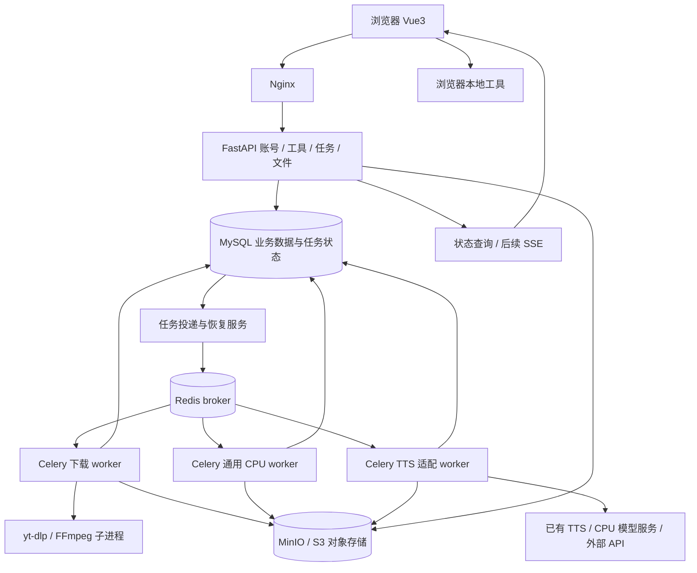

# 工具箱 Web 平台：GitHub 调研与落地方案

调研日期：2026-09-24。技术目标：FastAPI + Vue3 + Celery + MySQL + Redis + MinIO/S3。

已确认场景：个人或小团队内网使用；TTS 先用 CPU 或外部 API，以后接 GPU。用户进一步指定参考 FastapiAdmin、FastSoyAdmin、abus-aikorea/voice-pro、AutoClip 进行二次开发。本方案中 AutoClip 指 `zhouxiaoka/autoclip`。

本次交付为二次开发调研和实施设计，未部署新平台、修改已有项目或运行上游项目。文中的架构、默认配额、资源预算和工期是实施建议，不是实测结果。

## 1. 结论与推荐路线

建议建设一个**模块化单体工具平台，配独立 Celery worker 和独立模型服务**。统一账号、工具目录、任务中心和文件中心，每种工具只实现参数、处理逻辑和必要的专用页面。

具体组合：

- **平台主底座：FastapiAdmin（FastAPI + SQLAlchemy + Vue3/Element Plus）。** 复用登录、权限、管理界面及存储接入；新增 Celery 工具任务中心。统一 ORM 和 UI 组件体系。
- **模块组织参考：FastSoyAdmin。** 借鉴业务模块注册、声明式菜单和代码生成的组织方式；不把其 Tortoise ORM 与 FastapiAdmin 混用，也不同时引入两套后台前端。
- **语音能力参考：Voice-Pro。** 参考 TTS、ASR、翻译和人声分离流程，按需封装成独立语音服务；首版只选 CPU/API 可用的少数能力。
- **视频流水线参考：AutoClip。** 复用经审查的字幕分析、精彩片段选择和 FFmpeg 剪辑逻辑，Vue 重做交互；统一接入本平台的 Celery、MySQL 和文件中心。
- **下载执行：复用现有下载项目的 yt-dlp/FFmpeg 逻辑，改接统一 Celery 任务。** 不把两个完整下载管理后台拼在一起。
- **TTS：优先给已有 CPU 工作台做 HTTP 适配器；需要较轻的新增引擎时，评测 Kokoro-FastAPI 或 sherpa-onnx。** 模型依赖与平台 API 分开安装、升级。
- **浏览器小工具：参考 IT-Tools 的分类、搜索和工具注册。** JSON 格式化、Base64、时间戳等直接在浏览器运行。
- **存储：保留 MinIO 接入，但业务仅依赖 S3 存储接口。** 新增长期部署需要认真考虑可维护的替代实现。

本次核查没有找到可直接交付、同时完整满足指定技术栈、统一 TTS/下载任务、文件归档及后续工具扩展的现成项目。下面的项目分别适合做底座、能力引擎和交互参考。

## 2. GitHub 项目比较

许可证为本次仓库页面或 LICENSE 的标注；具体复用按固定提交核查第三方依赖。这里比较的是适配成本，不以 Star 数代替质量评估。

| 项目 | 定位与已核查能力 | 许可证 | 在本平台中的用途 | 需要补的部分 |
|---|---|---|---|---|
| [FastapiAdmin](https://github.com/fastapiadmin/FastapiAdmin) | FastAPI + SQLAlchemy + Vue3/Element Plus；管理模块和多存储接入；当前依赖使用 APScheduler | MIT | **本方案推荐的主底座** | Celery 长任务队列、取消、重试和统一执行状态需新增；定时调度不等于耗时作业系统 |
| [FastSoyAdmin](https://github.com/sleep1223/fast-soy-admin) | FastAPI + Tortoise ORM + Vue3/Naive UI；MySQL 可选依赖、业务模块自动发现、代码生成、RBAC | MIT | **模块化组织参考；完整替代底座候选** | 当前依赖未包含 Celery；选择它应统一采用其 ORM/前端，重做 AutoClip 数据适配 |
| [Voice-Pro](https://github.com/abus-aikorea/voice-pro) | Gradio 语音工具台；TTS、克隆、Whisper 系列 ASR、翻译、人声分离和下载 | GPL-3.0（仓库） | **语音业务流程和独立引擎服务参考** | 不是 Vue/Celery 平台；模型依赖重，CPU 能力逐项验证；保留代码来源及各模型许可 |
| [AutoClip](https://github.com/zhouxiaoka/autoclip) | FastAPI + SQLAlchemy + Celery/Redis；React 前端；字幕分析、高光选择、视频切片与合集 | MIT | **视频处理流程的主要二开来源** | 默认 SQLite/本地卷；迁移 MySQL/S3、任务状态与并发控制；前端重做为 Vue |
| [FastAPI Best Architecture](https://github.com/fastapi-practices/fastapi-best-architecture) + [配套 UI](https://github.com/fastapi-practices/fastapi-best-architecture-ui) | FastAPI、SQLAlchemy、Celery；支持 MySQL/PostgreSQL、Redis/RabbitMQ；Vue/Vben 前端 | MIT / MIT | 补充参考 Celery 集成 | 本轮不作为主底座 |
| [Async-FastAPI-MultiDB](https://github.com/GJCoke/Async-FastAPI-MultiDB) | FastAPI、Celery、MinIO、Socket.IO、SQLModel/Beanie 的后端示例 | MIT | 参考异步任务与对象存储的组合 | 不是完整 Vue 工具箱；多数据库和自定义异步 Celery 封装增加复杂度，README 尚列有重构 TODO |
| [IT-Tools](https://github.com/CorentinTh/it-tools) | Vue3、TypeScript、Naive UI；开发者工具集合，含工具生成脚本 | GPL-3.0 | **工具首页、搜索分类、前端工具模块参考** | 没有本方案所需的统一服务端长任务中心；依赖版本不能照搬 |
| [OmniTools](https://github.com/iib0011/omni-tools) | React + TypeScript + Material UI；浏览器工具集合，覆盖文本、图片等处理 | MIT | 参考工具分类和文件工具体验 | 与 Vue3 不同，不能直接复用 React 页面；服务端任务能力另做 |
| [MeTube](https://github.com/alexta69/metube) | 自托管 yt-dlp Web 下载器；视频/音频/字幕、队列、订阅、持久状态文件 | AGPL-3.0 | 参考下载参数预设、进度与结果交互 | 其队列及文件状态模型不是本平台 MySQL + Celery 模型；不作为统一平台内核 |
| [YTPTube](https://github.com/arabcoders/ytptube) | yt-dlp 下载管理、并发队列、定时来源、规则、API 和媒体库整理 | MIT | 第二阶段订阅、批量和规则功能参考 | 范围较大，不适合首版全部移植；当前默认分支为 dev，采用时需固定已验证版本 |
| [Kokoro-FastAPI](https://github.com/remsky/Kokoro-FastAPI) | 提供兼容 OpenAI 风格的语音接口及 CPU/GPU 部署路径 | Apache-2.0 | **独立 TTS provider 候选** | 不是通用工具平台；中文音色、吞吐、长文本效果需本机验证；README 提醒项目偏开发迭代 |
| [sherpa-onnx](https://github.com/k2-fsa/sherpa-onnx) | ONNX 离线语音推理框架，支持 TTS 等能力 | Apache-2.0（代码） | CPU TTS 引擎候选，亦可用于后续语音工具 | 自行封装服务、模型加载和音色映射；各模型权重单独核查 |
| [yt-dlp](https://github.com/yt-dlp/yt-dlp) | Python 音视频下载引擎，支持进度 hook、格式选择和后处理 | 源码为 Unlicense；打包产物另核查 | **下载工具的实际引擎** | 平台负责用户、配额、隔离、任务恢复及产物管理 |

推荐组合：**FastapiAdmin 主平台 + FastSoyAdmin 模块设计参考 + Voice-Pro 语音服务 + AutoClip 剪辑引擎。** IT-Tools/OmniTools 参考工具体验，MeTube/YTPTube 参考下载功能。每个项目承担明确职责，维护一个统一 Web 入口。

## 3. 四个指定项目的二次开发边界

### 3.1 FastapiAdmin 与 FastSoyAdmin 如何选择

推荐 FastapiAdmin，原因是它与目标数据层及 AutoClip 的 SQLAlchemy 实现更接近，已有 S3 存储依赖，适合在管理底座上新增媒体工具。FastSoyAdmin 的模块组织很适合参考，但换成它并非只替换 UI，会同时改变 ORM、路由、权限集成和数据访问方式。

| 维度 | FastapiAdmin | FastSoyAdmin | 本项目决定 |
|---|---|---|---|
| ORM | SQLAlchemy + Alembic | Tortoise ORM | 统一 SQLAlchemy，降低 AutoClip 数据模型迁移成本 |
| UI | Vue3 + Element Plus | Vue3 + Naive UI | 沿用主底座 Element Plus；参考工具卡片、搜索和模块设计 |
| MySQL | 当前设置默认 mysql | 可选 mysql/asyncmy 依赖 | 用真实 MySQL 跑迁移和并发状态测试 |
| 任务 | 当前依赖为 APScheduler | 当前 pyproject 未包含 Celery | 独立增加标准 Celery 应用和业务状态机 |
| 文件 | 有 boto3 等存储依赖 | 不预设具备完整媒体产物管理 | 复用存储接入，新建文件所有权、期限和任务关联 |
| 模块化 | 按主底座现有注册机制扩展 | `app/business/<name>` 自动发现与声明式初始化 | 借鉴 ToolSpec 注册及菜单权限声明，避免迁移框架内部实现 |

FastapiAdmin 需要明确修改的部分：关闭与工具箱无关的 AI 聊天、移动端等入口；新增工具目录、任务、文件、语音、视频项目模块；把耗时处理全部交给 Celery。平台周期清理选单实例 Celery Beat；已有 APScheduler 若保留，只负责其原有管理任务，避免重复调度。

当前设置里 `SCHEDULER_ALLOW_CODE_EXEC` 默认是 True，二开部署应设为 False；工具只能调用注册的处理器。上传设置仍是一般后台的小文件限制，媒体文件需新建配额受控的大文件上传流程，不能简单全局关闭限制。默认主机白名单和生产反向代理参数也要适配内网入口。

来源：[FastapiAdmin 依赖](https://github.com/fastapiadmin/FastapiAdmin/blob/master/backend/pyproject.toml)、[设置源码](https://github.com/fastapiadmin/FastapiAdmin/blob/master/backend/app/config/setting.py)、[FastSoyAdmin 架构与开发说明](https://github.com/sleep1223/fast-soy-admin)、[FastSoyAdmin 依赖](https://github.com/sleep1223/fast-soy-admin/blob/main/pyproject.toml)。

若明确更喜欢 Naive UI，可以整体改选 FastSoyAdmin，再按其 Tortoise 体系实现平台任务库；这是另一条可行路线，但不推荐 FastapiAdmin 后端再硬接整套 FastSoyAdmin 前端。

### 3.2 MinIO 社区版的维护状态已经变化

截至调研日期，`minio/minio` 页面标明 **2026-04-25 归档**，README 明确声明不再维护，并说明社区发行改为源码方式。不能继续套用“拉取 latest 就能长期获得社区更新”的旧教程。[MinIO 官方仓库](https://github.com/minio/minio)

对本项目的建议：

- 已有 MinIO 可作为过渡接入对象，固定构建来源和版本，使用私有桶；本次不修改已有服务。
- 业务提供 `StorageService`，使用 boto3 的标准 S3 接口；数据库仅保存 `storage_backend/bucket/object_key`，不保存永久下载 URL。
- 新增长期自托管候选包括 [SeaweedFS](https://github.com/seaweedfs/seaweedfs)（Apache-2.0，提供 S3 接口）。迁移前验证上传、HEAD、Range 读取、预签名、分片上传、删除和权限行为，不能仅凭“S3 兼容”就认为全部等价。
- MinIO 页面另指向 AIStor，免费许可与开源并非同一概念，应作为不同产品另行评估。

架构中继续标为“MinIO/S3”，既满足现有技术偏好，也保留后续替换空间。

### 3.3 Voice-Pro：参考完整语音流程，按能力拆服务

Voice-Pro 主界面是 Gradio，当前依赖包含 Whisper 系列、Demucs、多种 TTS 和 PyTorch。它的 `pyproject.toml` 定义了互斥的 CPU/GPU extras；但 README 同时说明当前主要在 Windows/NVIDIA 上验证，Linux/Mac 未验证，并有暂缓维护说明。因此“能安装 CPU 依赖”不能等同于所有模型都在 CPU 上可用、速度合适。

建议抽象为四类工具：`tts.synthesize`、`audio.transcribe`、`audio.separate`、`subtitle.translate`。首版实现 TTS；转写按需加入；人声分离和声音克隆在 GPU 阶段评测。下载能力复用平台唯一的下载工具，避免 Voice-Pro 再维护第二套 yt-dlp 队列。

实际接法：Vue 页面 → 平台 Job → Celery 适配器 → 独立 Voice Engine HTTP API → 平台 Artifact。直接二开 Voice-Pro 代码时，为选定处理函数增加服务封装，解耦 Gradio 组件/回调、全局输出目录和模型配置。HTTP API 是计划新增的封装，不声称上游已有完全符合本平台的稳定接口。

当前已有 GPT-SoVITS 工作台可作为第一个 provider；Voice-Pro 作为后续引擎和流程扩充来源。若直接复用其代码，单独保留 GPL-3.0 LICENSE、修改记录及第三方清单，权重许可逐个核查；不把其源码直接改标为 MIT，也不把 HTTP 隔离当作自动消除许可义务的结论。

来源：[Voice-Pro README](https://github.com/abus-aikorea/voice-pro)、[依赖和 CPU/GPU 配置](https://github.com/abus-aikorea/voice-pro/blob/main/pyproject.toml)。

### 3.4 AutoClip：迁移处理阶段，重新接平台任务与文件

本次以 `zhouxiaoka/autoclip` 的主仓库为准。当前依赖和 Compose 确认使用 FastAPI、SQLAlchemy、Celery/Redis；前端是 React，数据库默认 SQLite，视频通过本地共享卷传递。其桌面模式还有本地线程执行分支，本项目采用正常 Celery 路径，不迁入桌面启动/自动更新流程。

主要二开入口：

| 上游入口 | 可复用内容 | 必须适配的边界 |
|---|---|---|
| `backend/tasks/import_processing.py` | 上传后缩略图、字幕准备、启动分析的流程 | 输入改为 asset_id；统一 ASR provider；平台决定任务创建和下一阶段投递 |
| `backend/tasks/processing.py` | outline、timeline、titles、clips、collections 阶段拆分 | 不复用原 Task/Project 状态写入；改为本平台 job_steps 和媒体项目模型 |
| `backend/services/simple_pipeline_adapter.py` | 处理阶段连接、进度与结果整理 | 替换数据库/本地输出目录依赖，进度走 ExecutionContext |
| `backend/core/celery_app.py` | JSON 序列化、队列路由等配置参考 | 统一 broker、队列和超时；移除桌面线程回退；任务只传 ID |
| `frontend/` | 视频项目、字幕和片段预览交互 | React 页面用 Vue/Element Plus 重新实现，不直接复制组件 |

源码核查发现两处迁移时不能照搬的机制：`processing.py` 的进程内集合/线程锁无法作为多进程或多节点互斥；`retry_processing_step` 在 Celery 任务中对新任务调用 `.get()`，会引入同步等待与 worker 资源问题。新平台改用 MySQL 条件领取和持久化阶段调度，阶段结束后投递下一阶段，不在 worker 内阻塞等待另一个队列任务。这是局部源码评估，不是对整个项目的安全或质量审计。

首版 AI 剪辑流程：

```text
导入平台视频产物/上传素材
  → 已有 SRT 或统一 ASR 生成字幕
  → LLM 生成候选片段（结构化 JSON）
  → 用户预览并调整开始/结束位置
  → FFmpeg 精确裁剪、可选字幕烧录
  → 上传切片与合集到对象存储
```

先交付“视频 + SRT → 候选片段 → 导出”，可减少 CPU 转写耗时对剪辑验证的干扰。随后接自动 ASR。自动发布、账号 Cookie 管理、桌面打包和多平台排期不进入当前工具箱首版。

新增 `media_projects`、`transcripts`、`clip_candidates` 与 `job_steps`；保存字幕版本、prompt 版本、模型、开始/结束毫秒和输入产物 ID。LLM 输出用 schema 校验并约束 `0 <= start < end <= duration`，禁止把模型输出当 shell 参数。用户编辑后生成新渲染任务；重新分析也保留旧候选版本。阶段失败可从已完成的持久产物继续，不承诺原上游流程天然可断点恢复。

FFmpeg 处理仍需要本地 seekable 文件：worker 将 S3 输入拉到 attempt 临时目录，完成后上传产物并清理；S3 用于归档和跨 worker 交接，不直接假装成本地磁盘。

来源：[AutoClip](https://github.com/zhouxiaoka/autoclip)、[依赖](https://github.com/zhouxiaoka/autoclip/blob/main/requirements.txt)、[Compose](https://github.com/zhouxiaoka/autoclip/blob/main/docker-compose.yml)、[任务代码](https://github.com/zhouxiaoka/autoclip/blob/main/backend/tasks/processing.py)、[导入流程](https://github.com/zhouxiaoka/autoclip/blob/main/backend/tasks/import_processing.py)、[流水线适配器](https://github.com/zhouxiaoka/autoclip/blob/main/backend/services/simple_pipeline_adapter.py)。

## 4. 现有本地项目怎么复用

本次只读取文档和相关代码；历史验收记录不代表服务当前在线。

| 已有资产 | 核查结果 | 推荐迁移方式 |
|---|---|---|
| [music-video-downloader](E:/xhh/projects/music-video-downloader/README.md) | Vue3 + FastAPI；当前后端已有 Redis、S3 存储及独立 worker；配置默认 PostgreSQL；worker 读取 Redis 唤醒队列 | 提取下载参数校验、探测、yt-dlp/FFmpeg 和播放器组件；将旧数据库与调度逻辑替换为新平台 MySQL/Celery 模块 |
| [gpt-sovits-cpu](E:/xhh/projects/gpt-sovits-cpu/README-LOCAL.md) | 独立 CPU 配音服务；`local_studio.py` 已有音色、创建任务、查状态、重试、取消和音频接口；使用 SQLite 保存自身工作台数据 | 首版作为外部 TTS provider 接入，保存 external_job_id 并归档结果；暂不迁移模型环境和全部历史 |

下载器 README 的数据位置部分仍包含旧的本地文件/数据库说明；新平台迁移前以源码和实际部署清单为准。不能直接把 PostgreSQL 的建表语句或状态领取 SQL 改个连接串就当作 MySQL 兼容。

TTS 适配流程：平台创建任务 → 适配器调用已有 `/api/jobs` → 保存外部任务 ID → 定期同步状态 → 成功后取回音频 → 上传平台对象存储 → 生成文件记录。音色通过 `/api/voices` 同步，取消通过已有取消接口转发。

需要补齐的一点：外部服务提交结果若在网络中断时不确定，不能自动重复 POST。优先增加以平台 task_id 为键的幂等提交/查询接口；未补齐前，将不确定提交标记为待核查而不是盲目重试。

旧 TTS 当前默认监听 Windows 本机。Linux 容器内的 `localhost` 不是 Windows 宿主机；实施时选择将模型服务容器化，或增加仅供平台访问的受控宿主机入口，再实测网络可达性。保持模型环境独立。

## 5. 平台结构



基础职责：

| 层 | 建议实现 | 职责 |
|---|---|---|
| 前端 | Vue3 + TypeScript + Vite + Pinia + Element Plus | 工具目录、参数表单、任务历史、试听预览和管理页面 |
| API | FastAPI + Pydantic + SQLAlchemy 2 + Alembic | 校验、权限、配额、任务创建、签名下载链接 |
| 业务数据库 | MySQL，建议从 8.4 系列选定经验证版本 | 用户、任务、执行尝试、文件、配额、投递记录 |
| 队列 | Celery + Redis | 按类型路由耗时任务；仅传 task_id 等小型 JSON |
| 临时状态 | Redis | 限流、可重建的短期状态；不作为任务历史唯一存储 |
| 对象存储 | S3 接口，支持接入 MinIO | 输入文件、音频、视频、字幕和缩略图 |
| 模型服务 | 独立进程/容器，HTTP 适配 | 模型常驻内存，CPU/GPU 依赖隔离 |
| 交付 | Docker Compose，Linux 容器 | 本机/内网部署；后续 worker 可迁移到另一台机器 |

首版 API 使用异步数据库会话；标准 Celery worker 可用独立同步 SQLAlchemy 会话，复用模型定义，不跨进程传 Session/连接。模型及 yt-dlp 不装进 API 镜像；文件处理依赖按 worker 镜像拆分。

**浏览器本地、短 API、后台任务三种执行方式分别处理。** JSON 格式化等留在浏览器；短校验可以直接调用 API；下载、探测、转码和 TTS 通过队列，避免请求超时。

## 6. 工具扩展规范

每个工具提供元数据、输入/输出 schema、处理器以及可选专用 Vue 页面。通用参数用 schema 表单；TTS 的段落编辑和播放器使用专用组件。首版插件随代码构建发布，不做任意代码上传或运行时安装市场。

建议逻辑目录（接入 FastapiAdmin 的现有模块注册，保留原核心路径）：

```text
toolbox-platform/
  backend/
    app/toolbox/
      catalog/              # 工具目录、启用状态和权限
      jobs/                 # 任务、投递、尝试、取消与恢复
      assets/               # 文件、存储和生命周期
      providers/            # 已有 TTS / Kokoro / 外部服务适配
      tools/
        video_download/     # schemas.py / handler.py / manifest.py
        tts/
        audio_convert/
        video_highlight/    # AutoClip 分析与渲染适配
        audio_transcribe/   # 统一 ASR provider
      contracts/            # ToolSpec / ExecutionContext / Artifact
    workers/                # 独立标准 Celery 应用
    migrations/
  frontend/
    web/src/views/toolbox/
      catalog/
      jobs/
      assets/
      tools/tts/
      tools/video-download/
      tools/json-format/
      tools/video-highlight/
  services/
    voice-engine/           # 独立环境，保留上游来源和许可
  deploy/
  docs/
```

工具描述示例（设计契约，非上游现有代码）：

```json
{
  "id": "video.download",
  "version": "1.0.0",
  "name": "视频下载",
  "category": "media",
  "execution": "job",
  "queue": "download",
  "input_schema_ref": "VideoDownloadInput",
  "output_schema_ref": "MediaArtifacts",
  "ui_component": "VideoDownloadPage",
  "permissions": ["tools:video.download:run"],
  "timeout_seconds": 1800,
  "max_output_bytes": 2147483648
}
```

工具处理器只获得受控的 ExecutionContext：`task_id`、`attempt_id`、参数、工作目录、日志、进度上报、取消检查、文件读写接口。统一执行器负责状态转换、重试和产物提交，避免每个工具重复实现。

工具 ID、版本、handler 和队列由后端注册表决定，客户端不能提交任意 Python 函数路径。任务创建时快照保存工具版本、参数和 provider/model 版本；升级后旧任务仍可追溯。worker 不支持某版本时显式失败，不静默按新逻辑执行。

增加一个工具的标准步骤：

1. 新建工具目录，声明输入/输出 schema 及资源限制。
2. 实现处理器，使用统一进度、取消和 Artifact 接口。
3. 注册工具和后端权限；提供表单或专用 Vue 组件。
4. 为 API 和相关 worker 部署同一套注册信息；新增系统依赖时更新对应镜像。
5. 验证成功、错误输入、取消、重复投递和越权读取场景。

例如后续接 OCR，只需增加 `image.ocr` 工具和执行依赖；账号、任务历史、文件预览、下载和配额继续复用。涉及新增业务实体时仍需正式数据库迁移。

## 7. 数据与接口设计

账号、角色和审计复用底座。工具箱新增下列表：

| 表 | 核心字段或约束 |
|---|---|
| `tool_settings` | tool_id、enabled、配置版本、管理员设定的配额；可执行注册表仍在代码里 |
| `jobs` | id、owner_id、tool_id/version、input_json、status、stage、progress、current_attempt、cancel_requested、created_at、finished_at |
| `job_attempts` | job_id、attempt_no、dispatch_generation、celery_task_id、worker_id、heartbeat_at、lease_until、external_job_id、error_code、开始/结束时间 |
| `assets` | id、owner_id、job_id、attempt_id、bucket、object_key、content_type、size、checksum、expires_at、status |
| `job_inputs` | job_id、asset_id、用途，关联受权限检查的上传输入 |
| `outbox` | 事务内创建的投递记录、publish 状态、下次重试时间和投递代次 |
| `quota_reservations` | owner_id、job_id、预留存储/运行额度、结算状态；防止并发提交绕过配额 |

`jobs(owner_id, created_at)`、`jobs(status, updated_at)` 建索引；`(job_id, attempt_no)`、`(owner_id, idempotency_key)` 建唯一约束。幂等键绑定规范化请求摘要，同一键携带不同参数返回冲突。复杂扩展数据使用 JSON，常用筛选字段独立列。

任务状态：

```text
PENDING_DISPATCH → QUEUED → RUNNING → SUCCEEDED
                           ├──────→ RETRY_WAIT → PENDING_DISPATCH
                           ├──────→ FAILED
                           └──────→ CANCEL_REQUESTED → CANCELED
```

排队任务可直接取消；运行任务先请求取消，再由执行器确认。文件过期记录在 `assets`，不把已成功任务改为失败。每次执行用新 attempt，旧 worker 的结果提交必须同时匹配当前 attempt 与有效租约，防止过期执行覆盖新结果。

建议 API：

| 接口 | 用途 |
|---|---|
| `GET /api/v1/tools` | 工具目录、可见权限、可用 provider |
| `GET /api/v1/tools/{tool_id}` | 工具表单 schema、预设和限制 |
| `POST /api/v1/jobs` | 提交工具参数；返回 202 和平台 job_id；支持 Idempotency-Key |
| `GET /api/v1/jobs` | 按所属用户、工具和状态分页查询 |
| `GET /api/v1/jobs/{id}` | 状态、当前阶段、进度、产物和可重试错误 |
| `POST /api/v1/jobs/{id}/cancel` | 请求取消 |
| `POST /api/v1/jobs/{id}/retry` | 根据策略创建新执行尝试，保留失败记录 |
| `GET /api/v1/jobs/{id}/events` | 第二步增加 SSE；首个闭环先轮询 |
| `POST /api/v1/assets/uploads` | 上传前校验配额，申请受限对象键和上传授权 |
| `POST /api/v1/assets/{id}/complete` | HEAD/大小检查，确认上传完成 |
| `GET /api/v1/assets/{id}/download-url` | 校验所有权后签发短期链接 |
| `GET /api/v1/tts/voices` | 统一查询音色与 provider 能力 |

所有任务、输入和产物接口都检查 owner_id；管理员跨用户操作单独授权并审计。预签名链接不写入长期数据库，浏览器可访问的对象存储域名必须独立配置；不能签发包含容器主机名 `minio:9000` 的外部链接。

## 8. Celery 可靠执行：首版就需要的部分

Celery 负责执行分发，**MySQL 的 jobs/attempts 才是用户看到的权威状态**。Celery 原生任务结果不足以承载业务历史、取消流程和产物权限。

### 投递、恢复与幂等

创建任务时，在一个 MySQL 事务中保存 job、配额预留和 outbox；独立 dispatcher 投递 Redis，成功后更新投递记录。数据库提交与消息发布无法形成同一事务，所以系统按可能重复投递设计。

worker 通过条件更新领取当前 attempt；已终态或不匹配代次的消息直接结束。执行期间更新租约心跳；恢复服务扫描长期未领取、租约超时和投递异常的任务，按限制创建重试投递。即使 Redis 丢失排队消息，也可从业务数据库对账重新投递。

产物先上传 attempt 专属对象键，提交文件记录前检查租约和 current_attempt。失效执行的对象由清理任务回收；不能两个 worker 覆盖同一文件并都宣布成功。

### 队列与进度

- `download`：建议从并发 2 开始；探测也有超时和网络限制。
- `cpu`：FFmpeg/图片等，从并发 1 开始，限制内部线程数。
- `tts`：CPU 推理端并发 1；HTTP 适配任务与模型执行额度分别控制。
- 后续 `gpu`：按 GPU 或模型实例分配 worker/服务，模型由独立服务常驻，避免每个 Celery 子进程加载一份。

外部异步 TTS 采用“提交 → 保存外部 ID → 周期查询 → 收集结果”的短任务，避免 worker 长时间睡眠占槽。查询次数、总时长和取消都设上限。

首版前端轮询 2 秒一次即可，小团队负载可控。随后加 SSE，断线后重新读取 MySQL 快照；如果没有持久事件表，不承诺完整事件重放。进度按“探测/下载/后处理/上传”等阶段展示，未知百分比用不定进度；没有可靠数据时不伪造精确百分比。

### 取消与重试

- 下载和 FFmpeg 用受控子进程组，软取消先终止、超时再清理整个进程组；清理临时文件。单独调用 Celery revoke 不能保证已运行子进程停止。
- TTS 取消转发到 provider；已有 CPU 工作台在当前段结束后生效，页面应如实显示“正在停止”。
- 网络瞬态故障用退避重试；不支持的站点、参数错误和资源超限直接失败。外部收费 API 的请求结果不确定时，不自动重发生成请求。
- `acks_late`、prefetch、worker 失联重投等必须结合幂等和有上限的失败处理配置，防止坏任务反复崩溃循环。

Redis 默认 visibility timeout 为 1 小时，超过该时间仍未确认的消息可能重投。建议首版单次工具执行限制 30 分钟，visibility timeout 留足执行及收尾余量；如有长任务先分段，并同时核对 broker/result backend/app 的相关配置。增大 timeout 也会延后故障重投，因此恢复要配合租约对账。[Celery Redis 文档](https://docs.celeryq.dev/en/stable/getting-started/backends-and-brokers/redis.html)、[任务文档](https://docs.celeryq.dev/en/stable/userguide/tasks.html)

Redis 开启 AOF，队列实例使用 noeviction。小团队可以先共用一个实例的不同逻辑 DB，但这不提供内存/故障隔离；缓存和队列增长后拆实例。API 进程内 BackgroundTasks 不承担持久化下载或模型任务。

## 9. 首批工具功能边界

### 视频/音频下载

首版：单 URL 探测、标题/封面/格式预览、固定格式预设、下载进度、取消/重试、文件试听/播放、短期下载链接。下载器使用 yt-dlp，FFmpeg 负责需要的合并/转码。[上游说明](https://github.com/yt-dlp/yt-dlp)

先迁移已有实现，保持媒体处理逻辑和 UI 可复用；不带入旧数据库状态机。首版可设最大 1080p、单任务 2 GiB、30 分钟执行上限，管理员可调整。这些是起始策略，不是平台成功率保证。MP4 仅是容器格式，浏览器兼容预设还需明确 H.264/AAC 与必要转码的成本。

格式预览与实际下载可能因站点变化失效，要给出清晰错误。JS runtime、yt-dlp-ejs 等根据固定版本和目标站点要求打入镜像，不能依赖运行时任意更新。播放列表、订阅和超长直播放第二阶段。

### TTS

统一参数：text、provider_id、model_id、voice_id、language、speed、format。各 provider 宣告自身能力，页面只显示其支持的选项，不能假设所有引擎都支持同样语速、流式输出、克隆或字幕。

首版：文本输入、预置音色试听、合成、段落进度、WAV/MP3 结果、历史任务。长文本按句切段，保存分段结果；默认上限建议先设 3000 字，测量后再提高。

优先接已有 CPU 服务；新增 CPU 方案在 Kokoro-FastAPI 和 sherpa-onnx 中二选一做对照，不同时引入全部推理栈。sherpa 官方提供中文/英文 Kokoro v1.1 模型包；它与其他 wrapper 默认模型、音色 ID 不能混为一谈。[模型包文档](https://k2-fsa.github.io/sherpa/onnx/tts/pretrained_models/kokoro.html)

评测样本包含普通中文、多音字、数字日期、中英混读和长文本。记录冷启动、内存、失败率以及 RTF（生成耗时/音频时长）；音质和速度以本机结果选择。外部 API 凭据只保存在服务端，提交前显示 provider 名称和预估消耗。

### 扩展验证工具

首版再加入 JSON 格式化、Base64、时间戳三个浏览器工具，验证本地执行模式；加入音频格式转换验证“新服务端工具无需复制任务系统”。以后可按需求接 OCR、字幕提取、语音转写、PDF 处理、图片压缩和音乐生成。

## 10. 部署、资源与必要约束

采用 Windows 开发 + Docker Desktop/WSL2 Linux 容器运行，或直接部署到 Linux 主机。Celery 官方不支持 Windows 原生运行，Linux worker 才作为验收目标。[官方 FAQ](https://docs.celeryq.dev/en/stable/faq.html#windows)

建议 Compose 服务：`web`、`api`、`mysql`、`redis`、`object-storage`、`dispatcher`、`worker-download`、`worker-cpu`、`worker-tts`。模型服务作为可选 profile 或外部地址。清理与对账由单实例调度器触发；需要周期任务时可使用单实例 Celery Beat。Flower 仅作为可选运维服务。

建议资源预算（未实测）：

| 场景 | 起始预算 | 并发策略 |
|---|---|---|
| 使用外部 TTS API | 4 核、8 GB RAM、50 GB 以上可用磁盘 | 下载 2、CPU 转码 1，模型不占本机内存 |
| 本地 CPU TTS | 8 核、16 GB RAM 起，预留模型及临时磁盘空间 | 推理 1、转码 1，限制线程，实测后调整 |
| 后续 GPU | 平台服务不变，增加独立 GPU 模型服务 | 显存预算由具体模型和并发实测决定 |

临时磁盘预算至少考虑并发任务的原始流、合并产物和上传期间副本，不能只按最终文件大小计算。起始保留期建议产物 7 天，任务记录 30 天；收藏文件可单独延长。模型缓存独立于任务清理目录。

落地时包含以下工程约束：

- 只向内网提供 Web 入口；MySQL/Redis 和对象存储管理控制台走受控管理网络。用户通过统一账户访问，管理员与普通用户两种角色即可。
- 下载器仅接收 HTTP/HTTPS URL 和固定参数；拦截内网、环回、链路本地地址及重定向绕行，DNS 校验配合下载 worker 的网络出口限制。内部 TTS 使用单独受信 provider 地址。
- 外部下载和媒体处理子进程不继承数据库/存储密钥；使用白名单环境变量、非 root 用户、限额工作目录。worker 的控制逻辑上传结果，未来更强隔离可拆独立执行容器。
- 文件名与用户输入路径分离，每个 attempt 使用独立目录；存储私有桶，输出类型与大小验证后才公开给所属用户。
- 视频下载用于自有或已授权内容。代码许可证、模型许可证及媒体使用授权分别记录。
- 清理由数据库过期记录驱动并可重试；对象存储生命周期仅作补充。备份同时覆盖 MySQL、对象文件和必要配置，并做一次恢复演练。

## 11. 实施顺序、交付物和验收

估算假设：一名熟悉 Python/Vue/Docker 的开发者，复用现有代码，CPU 模型资源已可获得；约 **14～22 人日** 达到可稳定供小团队使用的版本。站点适配、模型安装和依赖冲突可能增加时间，不作为交付承诺。

| 阶段 | 预计投入 | 具体交付与通过条件 |
|---|---|---|
| P0 底座验证 | 1～2 人日 | 固定 FastapiAdmin 提交；登录可用；MySQL 迁移通过；新增 Celery/Redis worker 执行样例；S3 上传下载可用 |
| P1 平台闭环 | 3～4 人日 | 工具目录、jobs/attempts/outbox/assets、轮询任务列表；模拟处理任务从提交到产物下载；重复投递不会重复提交产物 |
| P2 下载接入 | 3～4 人日 | 移植已有下载核心和页面；固定测试样本下载、取消、失败重试；重启恢复；文件可播放且归属校验通过 |
| P3 TTS 接入 | 3～5 人日 | 已有 CPU 或一个外部 provider；音色、合成、进度、取消、历史；解决外部提交幂等；记录耗时和音质样例 |
| P4 扩展与交付 | 4～7 人日 | 三个浏览器工具+音频转换；SSE 可选；配额、清理、备份恢复、部署文档、关键故障测试与验收报告 |

上面的 14～22 人日是基础工具箱（TTS/下载）的估算。**AutoClip 首版迁移另计约 5～8 人日**：视频+SRT 导入、结构化候选、Vue 预览编辑、裁剪/字幕导出、阶段重试及测试。自动 ASR 视 provider 接入情况另计约 2～4 人日。Voice-Pro 的全部语音能力不纳入该估算；GPU 克隆、人声分离和完整多语言配音单独排期。

二开迭代顺序：v0.1 账号/目录/任务/文件 → v0.2 视频下载/TTS → v0.3 AutoClip 字幕高光剪辑 → v0.4 ASR/翻译/更多语音 provider → v0.5 GPU 和组合流程。工具之间通过 asset_id 传递，例如“下载结果 → 高光剪辑”复用同一份素材。

关键验收场景：

1. 用户 A 不能读取、取消、预览或下载用户 B 的任务/产物。
2. Redis 暂不可用时，数据库已提交任务可以在恢复后继续投递。
3. worker 在执行中退出、消息重复投递、上传成功后提交数据库前退出，都不会产生互相覆盖的“成功结果”。孤立文件可回收。
4. 取消下载能停止其子进程；TTS 按 provider 的实际粒度停止，最终状态一致。
5. 磁盘满、文件超限、provider 超时和格式不支持时，页面有可理解的错误，配额正确释放。
6. 产物过期后链接失效且数据库记录同步；备份恢复后文件和任务引用一致。
7. 新增音频转换工具时，不改账号体系、任务核心表结构和文件下载流程。

性能仅设置待测目标：常规任务提交接口 P95 小于 500 ms（不含媒体探测和模型执行），2 秒轮询能展示新状态，下载软取消目标 10 秒内结束；TTS 取消目标由单段执行时间决定。实施报告必须区分目标与实测值。

首轮开发建议新建独立项目 `E:\xhh\projects\toolbox-platform`，保留两个现有项目可运行。先打通“登录 → 创建任务 → Celery 执行 → S3 文件 → 下载”，再迁移真实工具；旧历史默认保留在旧应用，后续单独做可回滚导入。

## 12. 调研证据与限制

- 已通过 GitHub 官方页面核查上述项目的定位、许可证及关键说明；核心候选进一步读取了依赖与配置源码。
- GitHub REST API 在本次请求中返回匿名访问限流 403，因此没有把最新提交日期、Release 日期或精确 Star 数作为结论依据。网页可读不等于已验证维护质量。
- 没有对候选仓库执行构建、自动化测试、部署或性能测试；“可落地”指已明确改造范围与验收路径，不代表已完成集成。
- 引用的主分支内容会变化，P0 必须记录固定 commit、锁文件、镜像摘要、许可证与模型来源。
- 本地资产仅做文档与局部代码核查；未探测现有服务端口、未修改模型配置或既有数据。

补充一手来源：[FBA 依赖](https://github.com/fastapi-practices/fastapi-best-architecture/blob/master/pyproject.toml)、[FastapiAdmin 依赖](https://github.com/fastapiadmin/FastapiAdmin/blob/master/backend/pyproject.toml)、[IT-Tools 依赖](https://github.com/CorentinTh/it-tools/blob/main/package.json)、[IT-Tools LICENSE](https://github.com/CorentinTh/it-tools/blob/main/LICENSE)、[Kokoro-FastAPI](https://github.com/remsky/Kokoro-FastAPI)、[Celery Tasks](https://docs.celeryq.dev/en/stable/userguide/tasks.html)。
