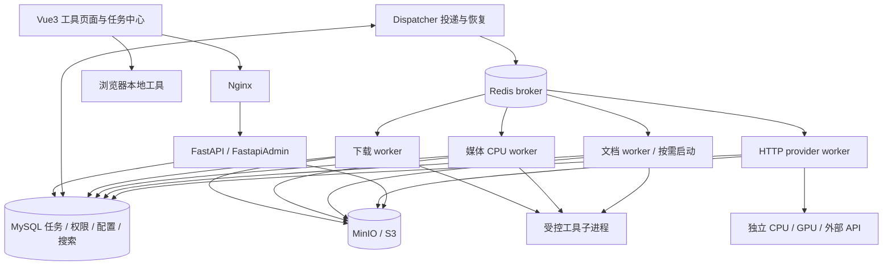

# 插件式 Web 多功能工具箱：全套开发方案

版本：v1.1｜更新日期：2026-09-24｜状态：开发设计，尚未按本文完成系统实现或部署验证。

适用场景：个人与小团队内网使用；先支持 CPU/外部 API，后续增加 GPU。以 FastapiAdmin 为主底座，参考 FastSoyAdmin、Voice-Pro、AutoClip 做模块化二次开发。

**明确不使用 Elasticsearch（ES）、Nacos，也不在后续阶段预留其接入任务。** 搜索使用 MySQL；服务地址使用 Docker Compose DNS 或管理员配置的固定地址；配置使用环境变量、受控配置文件与 MySQL 版本化设置。

本文是开发实施主文档。上游项目事实与迁移分析见[GitHub 调研与落地方案](E:/xhh/docs/工具箱Web平台-GitHub调研与落地方案-2026-09-24.md)。所有资源和工期数字均为起始预算或待测目标，不是性能承诺。代码块为契约或配置示例，不是已经验证可直接启动的平台代码。

## 1. 项目目标与首版范围

建设统一的工具入口，让不同工具复用账号、权限、参数校验、任务进度、文件、历史与搜索。主体采用模块化单体，耗时任务由独立 worker 执行，模型服务独立部署。

### 1.1 首版交付

| 模块 | 首版内容 | 完成标准 |
|---|---|---|
| 工具目录 | 分类、搜索、收藏、可用状态 | 能发现并打开有权限的工具 |
| 工具页面 | 通用表单、文件选择、参数预设、结果展示 | 普通工具通过 Schema 接入；复杂工具有专用组件入口 |
| 任务中心 | 排队、运行、取消、重试、错误详情、历史 | 重启后状态可核对，任务与产物不越权 |
| 文件中心 | 上传、试听/预览、下载、过期清理 | 文件可追溯到任务、用户和执行版本 |
| 管理后台 | 用户角色、工具启停、provider 配置、运行额度 | 复用 FastapiAdmin 体系，不维护第二套账户 |
| 第一批工具 | 视频下载、TTS、音频转换、JSON/Base64/时间戳 | 验证后台任务与浏览器本地两种执行方式 |
| 后续首轮扩展 | AutoClip 字幕高光剪辑、ASR | 使用同一任务、文件和权限体系 |

首版不建设任意代码插件市场、可视化通用工作流编排器、多租户计费系统或自动对外发布。下载和语音工具按实际需求逐项加入，不把上游项目全部功能一次性移植。

### 1.2 关键表述的实现边界

| 原方案中的目标 | 本方案的准确约定 |
|---|---|
| 插件热插拔 | 已部署插件可动态启停；新增/升级 Python 代码和前端组件经过构建发布、worker 排空和重启 |
| 新增工具零前端开发 | 普通表单与标准结果无需专用页面；时间轴、字幕编辑、波形等需要专用 Vue 组件 |
| 闲置插件零资源 | API 不加载模型；插件描述、注册表仍消耗资源，已加载模型是否释放由独立模型服务策略决定 |
| 多队列完全隔离 | 队列负责分流；独立 worker、容器资源限制、执行进程和网络策略共同提供隔离 |
| 任意多插件不卡顿 | 限制启动导入、分页目录、懒加载页面，并实测注册数量和并发量的影响 |
| subprocess 列表参数杜绝注入 | 列表参数减少 shell 注入风险，仍需限制可执行程序、选项、路径、协议和继承环境 |

## 2. 技术栈与工程决策

| 层 | 选型 | 职责与边界 |
|---|---|---|
| 基座 | FastapiAdmin | 身份认证、RBAC、菜单、审计、基础管理页面 |
| 后端 | Python 3.12、FastAPI、Pydantic v2 | HTTP API、输入校验、授权和任务受理 |
| 数据层 | MySQL 8.4 系列候选、SQLAlchemy 2、Alembic | 持久业务数据；最终补丁版本通过兼容验证后锁定 |
| 执行层 | Celery 5.6 系列候选、Linux prefork worker | 后台任务分发与执行；不承担唯一业务状态存储 |
| Redis | broker、短期状态、限流 | AOF、noeviction；不要把任务历史仅存在 Redis |
| 文件 | MinIO/S3、boto3 适配 | 私有对象存储；数据库保存对象键与元数据 |
| 检索 | MySQL 索引查询；按需使用 FULLTEXT/ngram | 先元数据搜索，再添加已提取文本的全文搜索 |
| 前端 | Vue3、TypeScript、Vite、Element Plus、Pinia、Vue Router | 沿用 FastapiAdmin 的前端约定 |
| 服务配置 | 环境变量/挂载配置文件＋MySQL 配置版本 | 静态基础设施设置与动态业务设置分开 |
| 部署 | Docker Compose＋Nginx | Windows 开发时使用 Docker Desktop/WSL2 Linux 容器 |

平台 API 使用异步数据库会话；标准 Celery worker 使用独立同步 SQLAlchemy 会话。可共享模型定义，不共享进程间数据库连接和 Session。同步 boto3 调用在 API 中放入受控线程执行或转交 worker，不阻塞事件循环。

MinIO 社区仓库已标注归档和停止维护，因此保留兼容接口、固定已验证构建，业务不绑定 MinIO 专有管理能力。新增长期存储可另外评测维护中的 S3 实现；这不改变插件接口。[MinIO 官方仓库](https://github.com/minio/minio)

### 2.1 开源项目复用范围

| 项目 | 复用内容 | 二开边界 |
|---|---|---|
| [FastapiAdmin](https://github.com/fastapiadmin/FastapiAdmin) | 登录、权限、菜单、审计、SQLAlchemy、存储接入 | 新建持久任务系统；其 APScheduler 管理任务不能替代 Celery 工具任务 |
| [FastSoyAdmin](https://github.com/sleep1223/fast-soy-admin) | 模块自动发现、声明式菜单、生成器的设计思路 | 不引入第二套 Tortoise ORM、Naive UI 和身份体系 |
| [Voice-Pro](https://github.com/abus-aikorea/voice-pro) | TTS、ASR、翻译、人声分离的工具组织和选定处理逻辑 | Gradio 回调与模型依赖解耦；需要新建 HTTP 适配；CPU 能力逐项测试 |
| [AutoClip](https://github.com/zhouxiaoka/autoclip) | 字幕分析、片段选择、剪辑与合集阶段 | React 页面改写 Vue；原有 SQLite、Task 模型、本地路径与执行状态由平台适配替换 |

复制代码时记录仓库、commit、原文件路径及修改点。FastapiAdmin/FastSoyAdmin/AutoClip 仓库标注 MIT；Voice-Pro 标注 GPL-3.0，保留来源、许可证和修改记录，模型权重及第三方依赖单独记录。服务拆分是工程边界，不据此推断许可义务自动消失。

## 3. 架构与任务链路



任务链路：

1. 前端读取工具描述、Schema 和允许使用的参数预设。
2. API 校验权限、输入文件所有权、参数、工具可用性及额度。
3. 在一个 MySQL 事务中保存任务、首次尝试、额度预留和 outbox 投递记录，返回 HTTP 202。
4. dispatcher 从 outbox 发布消息到 Redis；worker 根据任务 ID 和执行代次条件领取任务。
5. worker 获取固定版本的插件与配置快照，将需要的输入下载到本次尝试的临时目录。
6. 执行处理器，持续检查取消、上报阶段和心跳；模型处理可交给独立 provider。
7. 校验产物，上传到本次尝试专属对象键；在有效租约内提交文件元数据和成功状态。
8. 前端轮询或接收 SSE 更新；文本索引作为可重试的派生任务处理，不阻塞主工具成功。
9. 清理临时文件、过期对象、孤立上传和过期日志；保留规定期限内的任务摘要。

控制面统一用 MySQL 状态解释结果，不能直接用 Celery 的 PENDING 判断任务是否存在。

## 4. 项目目录与模块职责

以下为新增模块的建议位置；实施时接入 FastapiAdmin 现有路由、配置和迁移机制，保留其原目录，不整仓覆盖成新脚手架。

```text
toolbox-platform/
├── backend/
│   ├── app/
│   │   ├── ...                      # FastapiAdmin 原有模块
│   │   └── toolbox/
│   │       ├── api/                 # tools/jobs/assets/providers/search
│   │       ├── models/              # SQLAlchemy 模型
│   │       ├── schemas/             # HTTP 契约
│   │       ├── services/            # 事务、权限与业务规则
│   │       ├── contracts/           # ToolSpec/Context/Result/Provider
│   │       ├── registry/            # 描述扫描、版本与部署能力校验
│   │       ├── runtime/             # runner、取消、工作目录、子进程
│   │       ├── jobs/                # 状态机、outbox、恢复、额度
│   │       ├── storage/             # S3 适配、上传确认、生命周期
│   │       ├── search/              # 元数据查询、文本提取和 MySQL 索引
│   │       └── providers/           # 既有 TTS、外部 API、语音引擎适配
│   ├── plugins/                     # 自研或经审核的插件包
│   │   ├── demo_echo/
│   │   ├── video_download/
│   │   ├── tts/
│   │   ├── audio_convert/
│   │   └── video_highlight/
│   ├── workers/                     # 标准 Celery 应用与固定任务入口
│   ├── tests/                       # 契约、集成、故障与端到端测试
│   └── ...                          # 沿用基座 Alembic 目录
├── frontend/web/src/
│   ├── views/toolbox/               # 首页、工具、任务、文件、搜索、管理
│   ├── components/toolbox/          # DynamicForm / ResultRenderer
│   ├── tool-views/                  # TTS 编辑、字幕、剪辑专用组件
│   └── ...                          # 沿用原 API/状态/权限体系
├── services/voice-engine/           # 可选独立模型环境和接口
├── deploy/
│   ├── compose.yaml
│   ├── compose.dev.yaml
│   ├── nginx/
│   ├── mysql/
│   └── redis/
├── .env.example                     # 只有示例变量，无真实密钥
├── upstream-lock.json               # 上游提交、插件与模型版本来源
└── docs/                            # 部署、插件指南、API、验收与恢复
```

业务模块依赖 contracts 和 services；插件不能自行写平台任务状态表、创建数据库连接池或直接发布下一个 Celery 任务。跨工具输入通过 asset_id 和已发布的服务接口传递。

## 5. 插件契约与注册机制

### 5.1 插件与工具的区别

插件是构建、依赖和版本发布单位；一个插件可提供多个工具。工具是用户可执行的功能，有独立输入、输出和授权。任务同时记录 plugin_id/plugin_version、tool_id/tool_version、schema_hash，避免升级后无法解释历史结果。

三种执行模式：

| 模式 | 场景 | 执行方式 |
|---|---|---|
| `browser` | JSON、编码、时间戳等 | 已构建的前端代码本地运行，默认不上传内容或创建任务 |
| `request` | 小型校验、已缓存的选项查询 | API 内受限执行，超过预算则改为 job |
| `job` | 下载、转码、TTS、OCR、剪辑、远程探测 | MySQL 持久化后交给 Celery |

浏览器工具代码仍需构建进前端；后端不能通过 Schema 动态下发任意 JS 执行。

### 5.2 单插件结构

```text
plugins/audio_convert/
├── manifest.json              # 静态元数据，无执行副作用
├── schemas.py                 # 轻量 Pydantic 输入/输出定义
├── handler.py                 # 延迟导入的执行逻辑
├── ui.schema.json             # 可选，组件与布局提示
├── tests/                     # 成功、失败、取消、文件权限
└── README.md                   # 用途、资源、依赖、版本来源
```

manifest 示例：

```json
{
  "plugin_id": "media.audio_convert",
  "plugin_version": "1.0.0",
  "sdk_api_version": "1",
  "tools": [{
    "tool_id": "audio.convert",
    "tool_version": "1.0.0",
    "title": "音频格式转换",
    "category": "media",
    "execution": "job",
    "handler": "plugins.audio_convert.handler:run",
    "input_model": "plugins.audio_convert.schemas:ConvertInput",
    "output_model": "plugins.audio_convert.schemas:ConvertResult",
    "resource_profile": "media_cpu",
    "ui_renderer": "schema",
    "capabilities": ["asset.read", "asset.write", "ffmpeg"],
    "timeout_seconds": 1800,
    "max_output_bytes": 2147483648
  }]
}
```

`resource_profile` 由平台映射到队列和容器，不让插件随意创建队列。manifest 中的 capability 是声明和校验信息，不等于运行时安全沙箱；实际权限由 API、runner 和部署策略执行。客户端不可提交 handler、队列、任意命令或文件系统路径。

### 5.3 处理器接口

逻辑契约：`run(context, validated_input) -> ToolResult`。平台负责输入验证、状态转换、文件提交和错误映射。

| Context 能力 | 约定 |
|---|---|
| `task_id / attempt_id` | 平台身份与当前尝试，不由插件生成 |
| `workspace` | attempt 专属临时目录，只能访问授权输入与本次输出 |
| `assets.materialize(asset_id)` | 验证关联权限，拉取文件并返回受控路径 |
| `progress(stage, current, total)` | 上报真实进度；无法估计总量时 total 为空 |
| `log(level, message)` | 结构化日志，限制大小并脱敏 |
| `check_cancelled()` | 循环、分段与外部调用边界协作检查 |
| `run_process(executable_id, args)` | 使用注册可执行程序、列表参数、超时和进程组 |
| `provider(provider_id)` | 获取受控 provider 客户端，不向前端暴露密钥 |
| `emit_artifact(path, metadata)` | 声明产物；由 runner 校验、上传和提交 |

ToolResult 包含 `summary`、有限大小的 `structured_data`、`artifacts` 和 `warnings`。大段文本、字幕和原始结果保存为文件，不塞入 Redis 消息。插件失败抛出标准错误，不能先返回 success 再异步写最终文件。

### 5.4 发现、启停与版本发布

1. 构建阶段扫描允许目录中的 manifest，检查重复 ID、SDK 兼容、schema_hash、handler 和依赖。
2. 生成统一 registry 清单和 JSON Schema，打入 API/worker 镜像；API 启动优先读取生成物，不导入 torch/whisper 等模型代码。
3. 数据库维护启停、显示顺序、权限映射和管理员资源限制；代码注册表决定可执行能力。
4. worker 心跳上报支持的插件版本与资源类型；API 只有在已部署可用能力满足时才受理新任务。
5. 普通禁用阻止新任务，已受理任务继续排空；安全停用可阻止排队领取并请求取消运行任务。两种动作在管理界面分别命名并审计。
6. 首版升级采用维护窗口：停新提交 → 排空/明确取消旧任务 → 备份 → 迁移 → 发布同版本 API/worker/frontend → 冒烟验证 → 恢复。

首版不在同一 Python 进程里加载同 plugin_id 的多个代码版本。若未来需并行版本，使用独立部署池和版本化路由；旧排队任务不能静默改用新版本。

## 6. 动态表单与标准结果

Pydantic JSON Schema 提供参数结构和验证信息，但不会自动描述全部 UI 交互。增加 `ui.schema.json` 指定控件、分组、顺序、说明和选项数据源。[Pydantic JSON Schema 文档](https://docs.pydantic.dev/latest/concepts/json_schema/)

### 6.1 首版支持的 Schema 子集

| 数据类型/约束 | UI 控件 | 限制 |
|---|---|---|
| string | 单行、多行文本 | minLength/maxLength；正则使用受控复杂度 |
| number/integer | 输入框、滑块 | minimum/maximum、步长 |
| boolean | 开关 | 展示默认值 |
| enum | 下拉/单选 | label 与实际值分离 |
| array of primitives | 多选/标签 | maxItems，首版不做任意嵌套编辑器 |
| object | 分组表单 | 限制嵌套层级、字段总数 |
| asset_id / asset_ids | 文件选择/上传 | 限制格式、大小、数量，后端再次授权 |
| provider/voice/model 选项 | 动态下拉 | 仅调用已注册 options API |

Pydantic 生成的本地 `$defs/$ref` 和可空联合在构建阶段解析/归一化；拒绝远程 `$ref`。复杂 `oneOf/anyOf` 除约定的可空类型外先不通用支持，检测后要求专用组件，不能丢弃约束后继续渲染。

隐藏或禁用字段不代表无需后端校验。参数预设保存版本和普通参数，凭据单独保存。最终以 worker 使用的固定版本 Pydantic 模型验证为准，API 与 worker Schema 不一致时拒绝执行并报告部署错误。

### 6.2 结果与专用组件

标准 ResultRenderer 支持文本、JSON、音频、视频、图片、文件清单、警告和下一步工具入口。HTML/SVG 等潜在主动内容默认按下载处理或经过受控净化，不能把任意产物 HTML 直接插入主页面。

TTS 段落重做、字幕编辑、AutoClip 时间轴采用编译期注册组件。manifest 仅引用白名单组件 ID，Vue 使用静态映射/懒加载，不加载任意远程脚本。组件通过同一任务和文件 API 工作。

## 7. 持久任务模型与状态机

### 7.1 数据表

账号、角色、权限和审计沿用 FastapiAdmin。新增表统一 `tb_` 前缀，数据库使用 utf8mb4，时间存 UTC，前端按 Asia/Shanghai 等用户时区显示。

| 表 | 核心字段/约束 |
|---|---|
| `tb_tools` | 工具 ID、启停、展示信息、配置版本；不存可执行任意代码 |
| `tb_jobs` | 用户、工具/插件版本、输入快照、status、stage、progress、当前 attempt、created/updated/finished |
| `tb_job_attempts` | job_id、attempt_no、celery_task_id、lease_token、lease_until、heartbeat、provider_job_id、错误码 |
| `tb_outbox` | job/attempt、事件类型、not_before、投递租约、发布次数、sent_at |
| `tb_job_events` | 自增 event_id、job_id、attempt_id、类型、有限 payload、时间 |
| `tb_assets` | owner_id、job/attempt、storage_backend、bucket、object_key、size、mime、checksum、状态、过期时间 |
| `tb_job_assets` | job、asset、input/output 用途，维护引用关系 |
| `tb_quota_reservations` | user/job、预留运行/存储额度、已用额度、结算状态 |
| `tb_providers` / `tb_config_versions` | 地址、能力、credential_ref、配置版本、启用状态 |
| `tb_worker_heartbeats` | worker、插件能力、资源 profile、版本、最近心跳 |
| `tb_asset_texts` | 第二阶段文本索引内容、来源、版本和索引状态 |
| `tb_media_projects` / `tb_job_steps` | AutoClip 阶段增加，处理业务项目与持久阶段，不与系统项目混淆 |

必需约束：`(owner_id,idempotency_key)`、`(job_id,attempt_no)`、每次尝试的投递事件标识、对象键分别唯一。常用索引：jobs 的 `(owner_id,created_at,id)` 与 `(status,updated_at)`；attempts 的租约过期时间；outbox 的 `(status,not_before,id)`；assets 的所属用户和过期时间。

SQLAlchemy/Alembic 使用与基座一致的用户主键类型和命名约定。MySQL JSON 保存扩展参数，但状态、所属用户、工具、时间等筛选字段独立建列；二次开发不直接复制上游 SQLite 建表语句。

### 7.2 状态转换

```text
PENDING_DISPATCH → QUEUED → RUNNING → SUCCEEDED
       │             │        ├──→ RETRY_WAIT → PENDING_DISPATCH
       │             │        ├──→ FAILED
       │             │        ├──→ RECONCILING → 恢复执行/人工处理
       │             │        └──→ CANCEL_REQUESTED → CANCELED
       └─────────────┴──────────────────────────────→ CANCELED
```

允许 worker 从 PENDING_DISPATCH 直接领取进入 RUNNING，处理“消息已到达、dispatcher 尚未写 QUEUED”的竞态。dispatcher 更新 QUEUED 必须带旧状态条件，不能把 RUNNING 覆盖回 QUEUED。

`RECONCILING` 仅用于外部任务是否已创建/计费无法确认等不确定状态，禁止盲目再次生成。自动重试新建 attempt 并保留历史；手动重试只接受可重试终态，使用事务保证不会双开。改变参数时创建新 job，并用 parent_job_id 关联。

任务成功与产物过期分开表示；文件过期不把成功任务变成失败。用户编辑片段属于媒体项目的“待确认”阶段，释放 worker 后等待用户，不让 Celery 任务长期挂起。

### 7.3 事务投递与恢复

任务受理事务一起写 job、attempt、额度和 outbox。发布方按短租约领取 outbox，提交数据库事务后访问 broker，避免持有长事务等待网络；发布成功但写 sent_at 前崩溃可能重复发送，靠执行幂等处理。

worker 用条件更新领取 attempt，生成 lease_token；只有当前 attempt 和有效 token 可以更新最终状态。消息中的 owner 或参数不作为信任来源，实际从数据库读取。执行中每 10 秒心跳、租约起始建议 60 秒，时钟判断使用数据库时间。

恢复服务每 30 秒检查：未投递、投递后长期未领取、运行租约过期、取消卡住、外部结果不确定。先核对有效租约与 provider 状态再决定动作；重新投递使用新代次，旧消息不能执行新尝试。超过恢复次数进入 FAILED/RECONCILING，避免无限循环。

过期 worker 即使后来完成，也不能提交产物；其 attempt 对象键交给孤立文件清理。数据库不可达、无法续租时，runner 应停止受控执行；远程任务可能仍在运行，必须保留 provider ID 并对账。此设计保证可恢复、可核对，不承诺所有外部副作用恰好一次。

## 8. Celery 队列、资源与取消

### 8.1 队列按资源类型划分

| 队列 | 任务 | 起始并发建议 | 资源与部署 |
|---|---|---|---|
| `toolbox.download` | yt-dlp 下载与探测 | 2 | 独立出口策略、流量和磁盘限制 |
| `toolbox.media_cpu` | FFmpeg、轻量媒体转换 | 1 | 限制容器 CPU 和 FFmpeg 内部线程 |
| `toolbox.document_cpu` | OCR/PDF/图片 | 1 | 按需启用；独立依赖及内存额度 |
| `toolbox.provider_io` | HTTP 服务提交、查询、结果收集 | 2 | provider 调用额度另计，不能用队列并发代替模型容量 |
| `toolbox.maintenance` | 清理、索引、对账 | 1 | 避免维护任务被大媒体任务阻塞 |
| `toolbox.gpu.<device>` | 后续 GPU 专用处理 | 每卡 1 起 | 绑定设备或指定模型服务，先实测显存 |

不是每个队列首日都启动 worker。首版只启动已用 profile；同主机的所有并发总和要受 CPU、内存、磁盘和 provider 容量约束。`custom_queue` 不能作为任意脚本共用的无限资源入口，自研工具同样申报资源 profile。

Redis 锁/信号量只能协调额度，不能保证显存一定够用。单 GPU 先采用独立模型服务＋并发 1，服务内控制模型加载和释放；将来多节点才增加有续租与失效处理的额度租约。

### 8.2 基础执行配置

| 参数/机制 | 推荐起点 | 说明 |
|---|---|---|
| JSON 序列化 | 仅接受 JSON | 消息只传 job_id/attempt_id 等小参数 |
| `worker_prefetch_multiplier` | 1 | 降低长任务囤积，不代表全局公平调度 |
| `task_acks_late` | 对幂等工具启用 | 先完成执行领取和重复消息处理 |
| `task_reject_on_worker_lost` | 首版保持关闭 | 由平台租约恢复；启用前验证崩溃循环控制 |
| `result_expires` | 若启用结果后端则 1 天 | 业务结果仍在 MySQL/S3；不用 Celery Canvas 时可不依赖结果后端 |
| 单次处理上限 | 软超时 1800 秒，硬超时 1860 秒作为示例 | 工具可设置更小值；长流程拆阶段 |
| Redis visibility timeout | 上述预算下示例 3600 秒 | 必须大于单次最长执行与收尾；不同任务预算变化时一并调整 |
| worker 进程回收 | 按任务数/RSS 实测配置 | RSS 回收不是硬内存隔离，容器仍需内存限制 |

不要把长期定时任务塞进大量 ETA 消息；MySQL 保存 not_before，由 dispatcher 到期投递。所有注册队列都必须有明确消费者，否则发布前拒绝或显示明确不可用原因。[Celery 配置](https://docs.celeryq.dev/en/stable/userguide/configuration.html)、[Redis broker 文档](https://docs.celeryq.dev/en/stable/getting-started/backends-and-brokers/redis.html)

### 8.3 取消、超时与错误

取消的权威标志在 MySQL。排队任务直接标记取消，worker 领取前再次检查；运行任务进入 CANCEL_REQUESTED，runner 在受控边界终止处理。成功提交与取消请求通过条件更新竞争，已终态任务不再被旧请求覆盖。

FFmpeg/下载器使用子进程组，先温和终止、超时再清理整个组；runner 被硬杀时还要依赖进程监督或容器隔离清理后代进程。不能假设杀 Celery 子进程会自动清理所有工具进程。

标准 Celery revoke 可作为排队优化，不能替代数据库取消。不要把 `revoke(terminate=True)` 做成普通用户取消实现，官方说明该选项用于管理员最后手段，会终止执行进程而非精确业务任务。[Celery worker 文档](https://docs.celeryq.dev/en/stable/userguide/workers.html)

错误分为 `INVALID_INPUT`、`PERMISSION_DENIED`、`UNSUPPORTED_SOURCE`、`RESOURCE_EXCEEDED`、`PROVIDER_UNAVAILABLE`、`TIMEOUT`、`CANCELED`、`EXECUTION_ERROR`、`SUBMISSION_UNCERTAIN`。是否重试由平台策略决定；网络瞬态退避重试最多 2 次作为起点，参数和权限错误不重试。付费生成请求结果不确定时先对账。

## 9. 文件、工作目录与额度

### 9.1 文件生命周期

```text
UPLOADING → VALIDATING → READY → DELETING → DELETED
                       └───────────────→ EXPIRED（用户展示状态）
```

`READY` 前的文件不能被工具选作输入。上传流程先申请受限对象键和额度，上传后校验存在性、长度、类型及必要的 checksum；文件扩展名和客户端 Content-Type 不作为唯一依据。

大文件使用分片/直传；未完成分片有独立清理。预签名上传目标为 staging 对象，确认完成后复制/封存为不可覆盖的最终对象键，防止尚未过期的上传 URL 改写已经校验过的输入。若选择可验证的对象版本策略，也必须保存版本 ID 并在读入时固定版本。

对象键由服务端生成，例如：`users/{owner}/jobs/{job}/attempts/{attempt}/{artifact_uuid}.wav`。原文件名仅作显示名称。下载授权每次检查所属用户和状态后生成 5 分钟链接，浏览器端只获取临时地址；已有签名链接在过期前仍可能可用，禁用账号不等于立即撤销全部已签发链接。

### 9.2 临时文件与产物

工作目录：`/work/{job_id}/{attempt_id}/`，位于受限临时卷。工具输入按授权 asset_id 拉取；禁止用户自定义系统绝对路径。FFmpeg 处理前 materialize 为本地可 seek 文件，结束后上传对象存储。

上传产物和 MySQL 提交不是同一事务：先上传 attempt 专属键，验证大小/摘要，再检查租约提交 assets 和成功状态；失败时不让孤立对象出现在用户结果里，由后台补偿清理。

预览按 MIME 白名单处理音视频、图片和文本，音视频访问须验证 Range 请求与签名 URL 的续签行为。S3 对外访问域名与内部 endpoint 分别配置；不要把容器内部地址签给浏览器，也不要在代理时改写已签名的 Host/路径。

### 9.3 配额与清理

首版建议：每用户运行中后台任务 2 个、待执行 10 个、单次下载输出 2 GiB、普通产物保留 7 天、任务摘要 30 天。TTS 文本上限先设 3000 字。这些属于可调整业务设置。

创建任务前事务性预留额度，执行时持续检查实际字节，成功后结算、失败后按保留产物结算并释放剩余额度。用户并发限制需要数据库/统一额度服务，Celery worker 并发或 task rate limit 不能替代全局用户额度。

正在被任务引用的输入不能自动删除。清理按 assets 引用、保留策略和有效租约判断，先标记再删除并对账；存储 lifecycle 只作补充。临时文件扫描先检查该 attempt 是否仍有效，不能只按文件年龄删除运行中目录。

## 10. 搜索方案：只使用 MySQL

### 10.1 首版：元数据检索

支持工具名称/标签、任务标题、文件名、状态、创建时间。工具目录可在小型注册表中前端过滤；任务/文件使用后端分页及 owner_id 过滤。列表采用 `(created_at,id)` 游标，避免无限加载历史。

名称前缀匹配优先；包含匹配仅用于有用户/日期/数量边界的小集合。不能把 `%keyword%` LIKE 当成能够使用普通 B-tree 高效全文检索的方案。

### 10.2 第二阶段：文本全文检索

TTS 文本、ASR/OCR 输出、字幕和工具明确输出的文本，由 `text_index` 派生任务生成 tb_asset_texts；索引失败只影响搜索可用性，不回退主任务成功状态。视频音频本身不能被全文搜索，须先有转写或字幕。

MySQL FULLTEXT 使用 ngram 支持中日韩文本。索引示意：

```sql
ALTER TABLE tb_asset_texts
  ADD FULLTEXT INDEX ft_title_content (title, content) WITH PARSER ngram;
```

查询示意（参数化，不拼接用户输入）：

```sql
SELECT t.id, t.asset_id, t.title,
       MATCH(t.title, t.content) AGAINST (:query IN NATURAL LANGUAGE MODE) AS score
FROM tb_asset_texts AS t
JOIN tb_assets AS a ON a.id = t.asset_id
WHERE a.owner_id = :current_user_id
  AND a.status = 'READY'
  AND (a.expires_at IS NULL OR a.expires_at > UTC_TIMESTAMP())
  AND MATCH(t.title, t.content) AGAINST (:query IN NATURAL LANGUAGE MODE)
ORDER BY score DESC, t.id DESC
LIMIT :limit;
```

以上是设计示例，实际列类型、参数占位与分页按 SQLAlchemy 实现。分页计数、摘要、自动补全也必须带同样的权限和有效期过滤，不能先全局查完再由前端隐藏。

ngram 默认 token 大小为 2；单字查询不保证命中，页面提示至少两个字符，或仅在有界元数据范围回退。token 大小属于启动配置，调整需要评估并重建受影响索引。停用词、相关度和中英混合查询用固定样本验收，不承诺等同专业搜索引擎。[MySQL ngram 官方文档](https://dev.mysql.com/doc/refman/8.4/en/fulltext-search-ngram.html)

大文本按段保存有界索引内容，例如每文件最多 1 MiB 索引文本；全文原件保留在 S3，超出时标注搜索覆盖不完整。使用资产摘要＋提取器版本去重重建；删除/过期文件同时清理索引，正文不写入 API 日志。

## 11. 配置与远程服务接入

### 11.1 配置分层

| 类型 | 位置 | 生效方式 |
|---|---|---|
| MySQL/Redis 地址、运行模式、S3 endpoint、签名密钥 | 环境变量或只读挂载文件 | 发布/重启；不通过普通工具表单修改 |
| 工具启停、展示、额度、默认 provider | MySQL 版本化配置 | 新任务读取最新版本；运行任务使用快照 |
| provider URL、模型、超时、能力 | MySQL 或管理员配置文件 | 管理员验证后发布版本，支持回滚 |
| API key/访问密钥 | Docker secrets/受控文件；必要时数据库加密 | 数据库仅保存引用和版本，主密钥独立备份 |
| 用户参数预设 | MySQL，按 owner_id | 提交时快照，禁止保存明文密钥 |

业务配置更新流程：编辑草稿 → Schema 验证 → 受限连接检查 → 原子发布新版本 → 写审计 → 通知缓存失效。Redis 通知只是优化，各进程还需用短 TTL/版本检查保证失效通知丢失后能收敛。正在运行的任务不随设置修改而改变模型、超时和参数。

配置界面区分普通用户可选值与管理员基础设置。FastapiAdmin 的任意代码定时任务能力不对工具用户开放，二开设置 `SCHEDULER_ALLOW_CODE_EXEC=False`。

### 11.2 HTTP provider 契约

Compose 内通过服务名，例如 `http://voice-engine:8000`；外部模型服务通过管理员登记的固定 URL。客户端仅传 provider_id，不能传任意 base_url。按 provider 配置连接/读取/总超时、重试、最大响应大小和并发额度。

统一接口由适配器实现，不要求所有上游原生实现同一路由：

| 方法 | 语义 |
|---|---|
| `capabilities()` | 模型、音色、格式、文本长度、取消粒度 |
| `health()` | 服务就绪与模型状态，健康并不等于仍有容量 |
| `submit(request, idempotency_key)` | 同步结果或外部 job_id |
| `status(external_job_id)` | 进度、状态、错误和结果描述 |
| `cancel(external_job_id)` | 明确支持即时/分段取消/不支持 |
| `collect(external_job_id)` | 拉取结果并归档到平台 |

异步服务采用短任务“提交、查询、收集”，下次查询时间保存数据库，不在 worker 里长时间 sleep。外部结果 URL 也要验证允许的主机、重定向与大小，不能绕过网络限制。

提交响应丢失时使用幂等键查询；上游不支持幂等/查询的，进入 RECONCILING，人工或适配器核实后再继续。平台取消不代表上游一定停止计费，按 provider 能力如实展示。

## 12. API 契约与前端页面

沿用 FastapiAdmin 登录、请求封装、错误响应与分页约定；以下是逻辑路由，接入时统一 `/api/v1/toolbox` 前缀，不另造身份体系。

| 方法与相对路径 | 功能 | 关键规则 |
|---|---|---|
| `GET /tools` | 分类与工具列表 | 过滤权限；展示未配置/离线/禁用原因 |
| `GET /tools/{tool_id}` | 描述、Schema、版本、能力 | 返回 schema_hash 与允许预设 |
| `GET /tools/{tool_id}/options/{source}` | 动态音色/模型等 | source 必须已注册 |
| `POST /jobs` | 提交任务 | 202；Idempotency-Key；只接收 tool_id/version、params、input_asset_ids |
| `GET /jobs`、`GET /jobs/{id}` | 列表与详情 | 所有权、游标分页、状态快照 |
| `POST /jobs/{id}/cancel` | 请求取消 | 可重复调用；终态返回当前结果 |
| `POST /jobs/{id}/retry` | 原参数重试 | 可重试终态、额度与版本兼容检查 |
| `GET /jobs/{id}/events` | SSE/事件补取 | 授权后读取，支持保留期内 event_id |
| `POST /assets/uploads` | 申请上传 | 上传额度、staging 键、大小与类型 |
| `POST /assets/{id}/complete` | 确认上传 | 校验并封存后 READY |
| `GET /assets`、`GET /assets/{id}` | 文件列表与详情 | 权限及有效期过滤 |
| `GET /assets/{id}/download-url` | 下载/预览授权 | 短时签名，不返回长期凭据 |
| `DELETE /assets/{id}` | 删除请求 | 活跃引用检查、幂等异步删除 |
| `GET /search` | 元数据/全文检索 | 权限过滤、长度/频率/范围上限 |
| `/admin/tools`、`/admin/providers` | 管理配置 | 版本发布与审计，复用管理员权限 |

同一 Idempotency-Key 绑定规范化请求摘要；相同请求返回原 job_id，不同请求返回 409。字段错误用 422；额度不足用 429；工具版本冲突用 409；无可用执行能力用 503。具体包裹结构沿用基座，并通过 OpenAPI 生成/校验 TypeScript 类型。

前端页面：工具首页、工具详情、任务中心、任务详情、文件中心、搜索、工具管理、provider 设置。TTS 和视频剪辑在工具详情内挂载专用组件，不使用 iframe 拼接多个应用。

首版 2 秒轮询状态；第二阶段 SSE 优化体验。SSE 只推事件或失效提示，断线后从 MySQL 快照恢复；保留期内可按 event_id 补取，事件缺口则返回 reset 提示。日志大段内容存文件，事件 payload 有大小限制。

Bearer token 场景使用支持请求头的 fetch 流式读取；若采用同源 HttpOnly Cookie，配套 CSRF 与 Origin 策略。不要把长期 token 放在 SSE URL。Nginx 为事件端点关闭缓冲并设置合理空闲超时，实际验证断线重连。

## 13. 首批插件二开方案

### 13.1 视频下载：`video.download`

复用现有 [music-video-downloader](E:/xhh/projects/music-video-downloader/README.md) 的 yt-dlp、预设、探测和播放器逻辑；数据库、任务和 Redis 唤醒机制迁移为平台契约。先支持单 URL，后续才做受限批量。

输入为 URL、格式预设、字幕选项；输出为媒体文件、缩略图、可选字幕和有限元数据。探测也是有网络超时的 job。固定 yt-dlp/FFmpeg 版本以及目标站点需要的 JS runtime/EJS 依赖；记录失败分类，不自动跟随 nightly 更新。

支持 HTTP/HTTPS、域名策略和固定参数。对解析、重定向、媒体分片下载统一实施网络出口限制；子进程不继承数据库或存储密钥。仅对有使用权限的内容下载，站点支持范围以固定测试样本验证。

### 13.2 TTS：`tts.synthesize`

输入：文本、provider、model、voice、language、speed、输出格式。页面基于 provider capabilities 显示支持项；音色 ID 与模型版本绑定。

优先接入已有 [GPT-SoVITS CPU 工作台](E:/xhh/projects/gpt-sovits-cpu/README-LOCAL.md)，映射音色、提交、状态、取消和音频接口。为外部提交增加幂等映射，独立保留其模型环境；容器访问 Windows 宿主机不能使用容器内 localhost。

新增引擎时参考 Voice-Pro，先接一个 CPU/API provider。长文本按句分段，保存段落文本摘要、音色/模型/参数版本及结果；重做段落只重算选定段落。模型常驻独立服务，避免每个 Celery 进程重复加载一份。

Edge-TTS 如后续纳入，作为联网 provider 显示，不能标为离线 CPU 推理。Voice-Pro 的完整模型栈不装入 API 镜像，其 CPU extras 也不代表每种模型都满足本机速度要求。

### 13.3 音频转换：`audio.convert`

用 FFmpeg 固定预设完成 WAV/MP3/M4A 等转换，作为插件 SDK 的扩展验收样例。该工具加入时应只新增插件、依赖声明和可选 UI 提示，不重写任务状态机或文件下载接口。

### 13.4 高光剪辑：`video.highlight`

参考 AutoClip 的导入、字幕分析、候选片段、标题和合集流程。第一步接受视频＋SRT，完成候选预览和导出，再接统一 ASR，避免一开始同时调试转写与剪辑。

```text
输入资产 → 字幕准备 → LLM 候选生成 → 用户确认片段
                                      ↓
             成品与合集 ← 字幕烧录/裁剪/拼接
```

阶段记录在 tb_job_steps：input_hash、工具/模型/prompt 版本、attempt、状态、产物引用和错误。上阶段完成与下阶段 outbox 在同一事务提交。外部调用前后仍按幂等与不确定状态处理，不在 Celery 任务内 `.get()` 阻塞等待另一个任务。[Celery 工作流文档](https://docs.celeryq.dev/en/stable/userguide/canvas.html)

LLM 返回的 JSON 必须通过结构化验证；时间约束 `0 <= start_ms < end_ms <= duration_ms`，限制片段数与长度。字幕编辑或时间段改变后创建新版本/渲染任务，保留原候选。仅在输入摘要和版本一致时复用已完成阶段。

AutoClip 原有进程内去重和本地目录不作为新平台跨 worker 协调手段。渲染 worker 拉取输入至本地，结果上传 S3；精确切点涉及重编码，不能将快速 stream copy 宣称为任意时间点帧准确裁剪。

### 13.5 文档与自研工具

后续按需要增加 `audio.transcribe`、`image.ocr`、`subtitle.translate`、`pdf.convert`。依赖冲突明显的工具拥有独立 worker 镜像或 HTTP 服务；不把全部 Python 包堆进一个环境。

自研脚本必须由维护者转换为注册插件或受控程序，提供参数 Schema、工作目录及超时。页面不提供任意脚本内容或可执行路径输入。Linux worker 无法直接执行普通 Windows EXE；此类工具通过受控 Windows HTTP 服务接入，平台 Celery 仍运行在 Linux。

## 14. 权限与执行安全

首版单组织、管理员/普通用户两类角色，工具执行权限按 `toolbox:{tool_id}:run` 映射到基座。任务和资产默认私有；共享是后续独立业务，不把“有工具权限”解释为“可看所有任务”。

任务详情、日志、搜索、取消、重试、输入资产、下载和 SSE 都在后端执行 owner_id/授权检查。管理员跨用户查看单独授权并审计。创建时与实际执行/读取敏感资产时都检查有效授权；历史结果访问使用当前权限。

执行约束：

- 维护者审核插件代码与依赖，插件加载本身相当于执行受信代码；API 不接收上传插件 ZIP 后即时运行。
- 子进程使用注册程序、固定选项、`shell=False`、受控路径和最小环境；FFmpeg 等仍限制网络协议和外部引用。
- 用户 URL 禁止访问环回、私网、链路本地及云元数据地址；DNS/重定向校验与执行网络限制配合。受信内部 provider 使用独立允许名单。
- worker 非 root、禁止 Docker socket、尽量只读根目录，工作卷可写；限制 CPU/RAM/PID/临时磁盘。容器不是任意不可信代码的完整沙箱。
- 密钥、授权头、Cookie、签名 URL 和完整文案不写常规日志；provider 凭据不返回给前端。
- 上传与解析限制压缩包解压大小、页数、像素、时长和输出总量；插件不能通过伪造扩展名绕过限制。

## 15. 部署、配置样例与运维

### 15.1 服务拓扑

基础服务：`web`、`api`、`mysql`、`redis`、`object-storage`、`dispatcher`、`worker-download`、`worker-media`、`worker-provider`、`worker-maintenance`。文档 worker、模型服务、GPU 服务和 Flower 使用按需 profile。

周期清理、索引对账与租约恢复统一由单实例 scheduler 触发（可用 Celery Beat）；dispatcher 专门处理 outbox。维护任务必须有数据库去重/租约，避免 scheduler 重启重复执行。首版不同时让 APScheduler 和 Beat 调度同一任务。

只向用户网络暴露 Nginx Web 入口及必要的 S3 下载/直传入口；数据库、Redis、Flower、模型和管理控制台限制在内部网络。Compose 内用服务名连接，健康检查控制依赖就绪，但应用仍要实现连接重试与故障恢复。

Celery 官方不支持 Windows 原生部署，因此验收环境选择 Linux 容器/主机。[官方 FAQ](https://docs.celeryq.dev/en/stable/faq.html#windows)

### 15.2 配置接口示例

以下变量名是新平台建议命名；实现时映射到 FastapiAdmin 原有设置，不能直接认为基座已经识别它们。

```dotenv
APP_ENV=production
APP_TIMEZONE=Asia/Shanghai
DATABASE_URL=<read-from-secret-or-protected-config>
CELERY_BROKER_URL=<read-from-secret-or-protected-config>
S3_INTERNAL_ENDPOINT=http://object-storage:9000
S3_PUBLIC_ENDPOINT=https://files.example.internal
S3_BUCKET=toolbox
S3_CREDENTIALS_FILE=/run/secrets/toolbox_s3
PLUGIN_REGISTRY_PATH=/app/registry.json
PLUGIN_CODE_INSTALL_ENABLED=false
DEFAULT_ASSET_RETENTION_DAYS=7
DEFAULT_JOB_RETENTION_DAYS=30
MAX_USER_RUNNING_JOBS=2
MAX_USER_PENDING_JOBS=10
```

生产镜像固定 tag/摘要，Python/前端依赖锁定；按 api、媒体执行、文档执行、模型服务分别构建。原有配置默认密钥、主机白名单、允许域名、上传限制和代理头均在部署前适配，不能复制演示配置直接上线。

### 15.3 Redis、存储与备份

队列 Redis 使用持久卷、AOF 与 noeviction；设置 maxmemory 后保留系统余量，内存满时让发布失败并留在 outbox 重试。小规模可共用不同逻辑 DB，逻辑 DB 不隔离内存、驱逐策略或故障；缓存增长后拆实例。

平台不依赖 Redis 重建任务历史。MySQL 必須备份 jobs/assets/config；S3 文件与配置主密钥分别备份。数据库备份不包含媒体本体，单机对象存储也不等于高可用备份。

恢复流程：停止投递 → 恢复 MySQL 与对应对象备份 → 核对配置密钥 → 把历史运行 attempt 标记待对账 → 检查对象引用 → 小批量恢复处理。不能恢复数据库后直接假设之前的 RUNNING 仍存在。

### 15.4 资源与可观测性

起始预算：外部 API TTS 场景 4 核/8 GB；本地 CPU TTS 8 核/16 GB 起，依模型实测调整。媒体临时盘至少考虑输入流、合并文件和最终产物同时存在。高并发优先加 worker 资源，不能只增加 concurrency。

结构化日志字段：request_id、job_id、attempt_id、tool_id、plugin_version、worker_id、stage、error_code、duration_ms。生命周期事件入 MySQL；大量工具日志按 attempt 存 S3/受限滚动文件，保留 7 天起。

监控至少包括待投递数、队列等待时长、运行数、成功/失败率、陈旧租约、取消耗时、provider 失败率、磁盘余量和对象清理积压。首版用管理页面和结构化日志即可，不额外引入大型监控栈。就绪探针检查 MySQL、任务投递条件和必要存储，存活探针只反映进程存活。

## 16. 开发阶段与交付标准

| 阶段 | 工作 | 验收产物 | 估算 |
|---|---|---|---|
| P0 基座固定 | 锁上游提交、裁剪页面、MySQL/Redis/S3、登录 | 基座可启动，迁移与权限检查通过 | 1～2 人日 |
| P1 插件契约 | manifest、Schema 子集、registry、通用表单、demo_echo | 插件契约测试；输入→结果可展示 | 2～3 人日 |
| P2 可靠任务与文件 | jobs/attempts/outbox、Celery、租约、取消、上传归档 | 重复投递/崩溃/越权集成测试 | 4～6 人日 |
| P3 首批真实工具 | 视频下载、已有 TTS provider、音频转换、浏览器工具 | 可下载、试听；新增插件不复制核心逻辑 | 4～6 人日 |
| P4 可交付版本 | 元数据搜索、清理、额度、备份、部署脚本和文档 | 实际部署与恢复报告 | 3～5 人日 |
| P5 可选扩展 | MySQL 全文索引、ASR、AutoClip 阶段 | 单独按功能验收，分批交付 | 另行排期 |

基础版本约 14～22 人日；AutoClip 视频＋SRT 首轮迁移约再需 5～8 人日，ASR 和全文检索按数据规模及 provider 情况补充估算。假设开发者熟悉 Python/Vue/Docker，复用已有资产，依赖下载顺利；这些不是固定工期承诺。

先打通 demo 工具，再接真实业务。不要先批量搬入所有模型依赖、再补任务和文件体系。已有下载器与 CPU TTS 保持独立可用，新平台通过抽取模块或 HTTP 适配逐步迁移。

## 17. 必须覆盖的验证场景

| 场景 | 预期结果 |
|---|---|
| 两次相同幂等键提交 | 返回同一 job；不同参数返回冲突 |
| 消息重复投递、dispatcher 发布后崩溃 | 同一有效 attempt 只被领取一次；不会重复提交最终文件 |
| Redis 不可用后恢复 | 已受理任务留在 MySQL/outbox，可恢复投递 |
| 排队消息丢失、worker 异常退出 | 超时对账后有界恢复；不永久卡 RUNNING |
| 旧 worker 在重试后返回 | 租约检查拒绝过期结果，不覆盖新 attempt |
| 上传后数据库提交失败 | 任务不假成功，孤立对象可清理 |
| 运行中取消、达到硬超时 | 受控子进程被清理，额度释放，状态可解释 |
| 外部生成提交响应丢失 | 幂等查询或 RECONCILING，不盲目重复生成 |
| 用户 A 操作用户 B 的任务/文件/搜索/SSE | 服务端拒绝，不泄露元数据或摘要 |
| 上传签名在完成后再次使用 | 已封存输入不被 staging 对象覆盖影响 |
| 工具禁用、代码升级、版本不匹配 | 新旧任务按策略排空或拒绝，无静默换版本 |
| CPU 转码与 TTS 同时运行 | 符合总资源额度，API 仍可响应 |
| 搜索索引失败或文件过期 | 主任务不变；搜索状态明确，失效文件不再可检索 |
| MySQL＋对象备份恢复 | 任务和文件引用一致，遗留运行状态完成对账 |

集成测试使用真实 MySQL/Redis/S3 兼容实例，不仅依赖 SQLite/fakeredis。前端构建/typecheck 与插件契约测试纳入 CI。模型音质、CPU RTF、站点下载成功率单独保存实际样本和结果。

待测性能目标：任务提交 P95 <500 ms（不含探测/推理），前端状态更新在 2～3 秒内可见，受控下载软取消目标 10 秒内；TTS 按 provider 的分段粒度说明。性能与恢复指标必须在验收报告标记实测环境和数据量。

## 18. 实施准备清单与参考来源

开始编码前固定以下产物：

1. FastapiAdmin、复用模块及模型的 commit/版本、LICENSE/NOTICE 和来源清单。
2. 平台新增表的 Alembic 迁移、工具 SDK v1、Schema 支持范围和 OpenAPI 契约。
3. registry 生成规则、worker profile/镜像、默认额度、provider 配置版本约定。
4. `.env.example`、部署拓扑、数据库初始化/升级步骤、数据备份与回滚说明。
5. 一个 demo 插件的真实端到端验收，随后接入视频下载与已有 TTS。

本文更新内容包括：移除独立搜索/配置中心依赖；明确 Schema 和插件发布边界；补齐任务一致性、文件生命周期、配置版本、资源控制、二开映射及验收路径。本文中的接口、SQL 与配置样例未经系统运行验证，实施完成后应附实际验收报告。

一手参考：

- [FastapiAdmin](https://github.com/fastapiadmin/FastapiAdmin)、[配置源码](https://github.com/fastapiadmin/FastapiAdmin/blob/master/backend/app/config/setting.py)
- [FastSoyAdmin](https://github.com/sleep1223/fast-soy-admin)
- [Voice-Pro](https://github.com/abus-aikorea/voice-pro)、[CPU/GPU 依赖定义](https://github.com/abus-aikorea/voice-pro/blob/main/pyproject.toml)
- [AutoClip](https://github.com/zhouxiaoka/autoclip)、[处理任务](https://github.com/zhouxiaoka/autoclip/blob/main/backend/tasks/processing.py)
- [Celery Tasks](https://docs.celeryq.dev/en/stable/userguide/tasks.html)、[Workers](https://docs.celeryq.dev/en/stable/userguide/workers.html)、[Redis](https://docs.celeryq.dev/en/stable/getting-started/backends-and-brokers/redis.html)
- [MySQL ngram 全文检索](https://dev.mysql.com/doc/refman/8.4/en/fulltext-search-ngram.html)、[Pydantic JSON Schema](https://docs.pydantic.dev/latest/concepts/json_schema/)
- [MinIO 仓库与维护状态](https://github.com/minio/minio)
